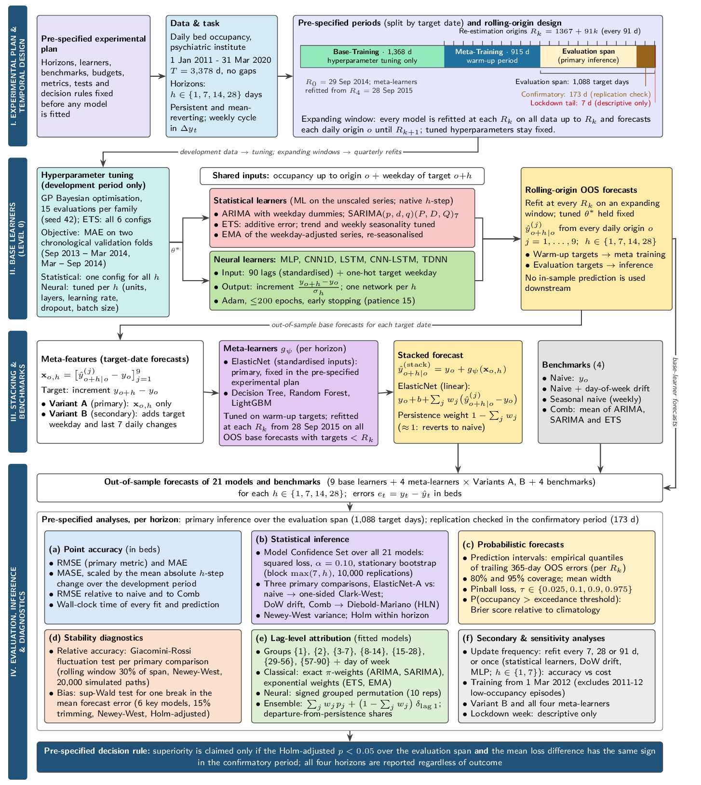
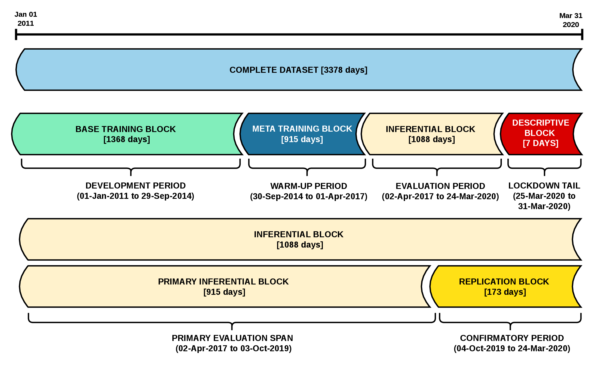
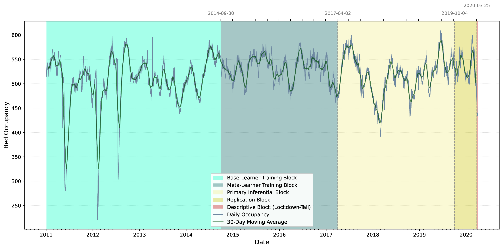
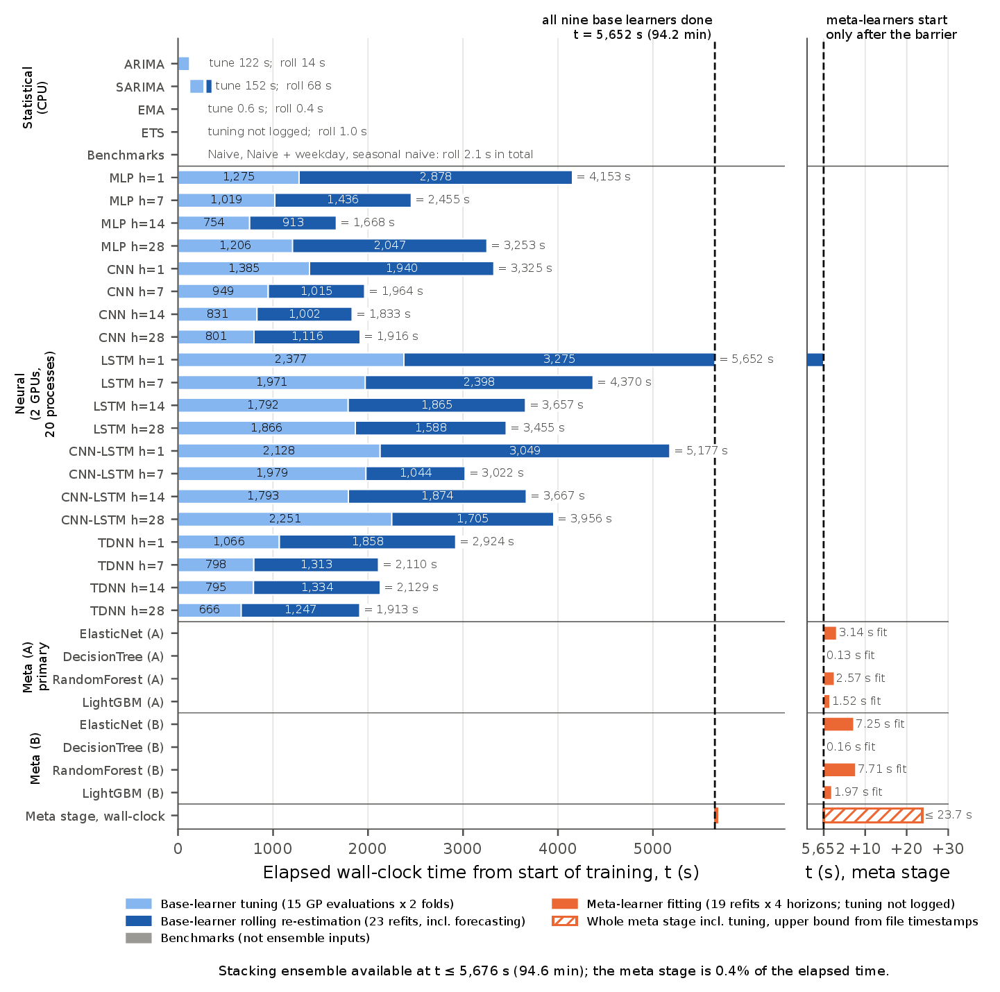
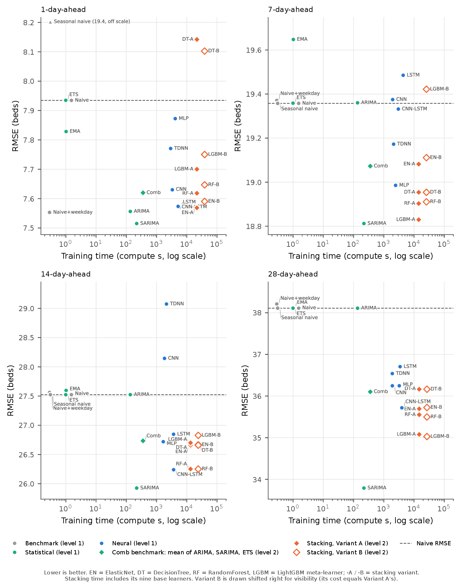
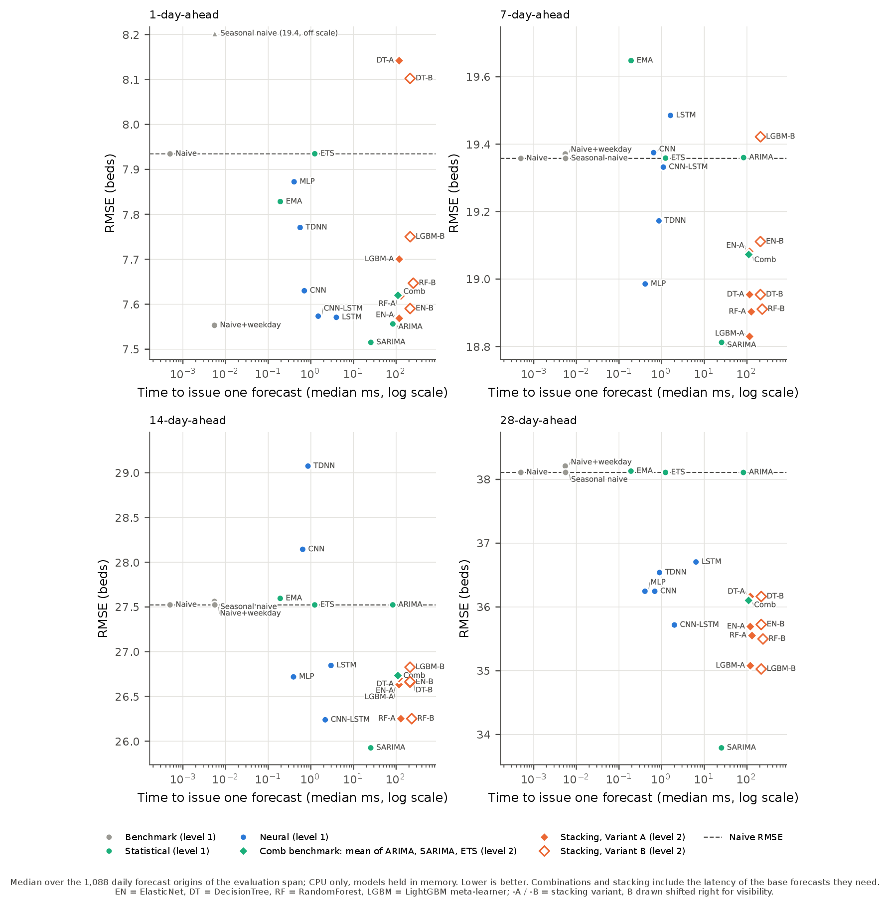
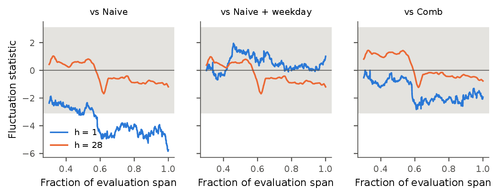

# Online supplementary material

Material referred to in the paper and in its Supplementary Material as being in the online repository.
Tables and sections of the Supplementary Material are numbered S1, S2, and so on; the items below are not.

## 1. Workflow of the study

(I) Experimental plan, data, target-date periods and rolling-origin design with quarterly re-estimation.
(II) Base learners, tuned once on development data with equal budgets, issue out-of-sample forecasts at
h = 1, 7, 14 and 28 days. (III) Meta-learners combine the target-date base forecasts, expressed as increments
over the origin value; four benchmarks are evaluated alongside. (IV) Evaluation of all 21 models and
benchmarks; superiority requires significance over the evaluation span and a loss difference of the same sign
in the confirmatory period.

## 2. Study periods

Periods are defined by forecast target date: development (to 29 September 2014; tuning only), warm-up
(to 1 April 2017; out-of-sample base forecasts train the meta-learners), evaluation span (2 April 2017 to
24 March 2020; 1,088 target days), whose final 173 days form the confirmatory period, and the seven lockdown
days from 25 March 2020, reported descriptively.

## 3. Search spaces and selected hyperparameters

Statistical learners were tuned once for all horizons; the networks and meta-learners were tuned separately for
each horizon. 15 evaluations of Gaussian-process Bayesian optimisation per family (ETS: all six configurations).
(a) Applied to the weekday-adjusted series.

| Model | Hyperparameter | Search space | h = 1 | h = 7 | h = 14 | h = 28 |
|---|---|---|---|---|---|---|
| ARIMA (a) | p | {0,...,5} | 0 | 0 | 0 | 0 |
|  | d | {0,1} | 1 | 1 | 1 | 1 |
|  | q | {0,...,3} | 1 | 1 | 1 | 1 |
| SARIMA | p | {0,...,3} | 1 | 1 | 1 | 1 |
|  | d | {0,1} | 0 | 0 | 0 | 0 |
|  | q | {0,...,3} | 0 | 0 | 0 | 0 |
|  | P | {0,1,2} | 1 | 1 | 1 | 1 |
|  | D | {0,1} | 0 | 0 | 0 | 0 |
|  | Q | {0,1,2} | 1 | 1 | 1 | 1 |
|  | s | Fixed at 7 | 7 | 7 | 7 | 7 |
| ETS | trend | {None, Add, Add + Damp} | None | None | None | None |
|  | seasonal | {None, Add} | None | None | None | None |
|  | m | Fixed at 7 | 7 | 7 | 7 | 7 |
| EMA (a) | span | {2,...,60} | 2 | 2 | 2 | 2 |
| MLP | hidden_units | {16,...,128} | 16 | 16 | 111 | 63 |
|  | num_layers | {1,2,3} | 3 | 3 | 2 | 3 |
|  | learning_rate | [10^-4,10^-2] (log scale) | 10^-4 | 10^-4 | 10^-4 | 10^-4 |
|  | dropout | [0,0.3] | 0.3 | 0.3 | 0 | 0.3 |
|  | batch_size | {16,32,64} | 32 | 64 | 32 | 16 |
| CNN | hidden_units | {16,...,128} | 75 | 16 | 16 | 102 |
|  | num_layers | {1,2,3} | 2 | 2 | 1 | 2 |
|  | learning_rate | [10^-4,10^-2] (log scale) | 10^-2 | 10^-2 | 10^-2 | 10^-4 |
|  | dropout | [0,0.3] | 0.25 | 0.3 | 0 | 0.3 |
|  | batch_size | {16,32,64} | 16 | 64 | 32 | 32 |
| LSTM | hidden_units | {16,...,128} | 71 | 128 | 86 | 105 |
|  | num_layers | {1,2,3} | 3 | 1 | 2 | 3 |
|  | learning_rate | [10^-4,10^-2] (log scale) | 10^-2 | 10^-2 | 10^-4 | 1.3 x  10^-3 |
|  | dropout | [0,0.3] | 0.3 | 0.3 | 0.19 | 0.14 |
|  | batch_size | {16,32,64} | 16 | 16 | 32 | 64 |
| CNN-LSTM | hidden_units | {16,...,128} | 16 | 16 | 66 | 16 |
|  | num_layers | {1,2,3} | 2 | 1 | 3 | 3 |
|  | learning_rate | [10^-4,10^-2] (log scale) | 10^-2 | 1.8 x 10^-4 | 10^-4 | 2.4 x 10^-4 |
|  | dropout | [0,0.3] | 0.3 | 0 | 0.29 | 0.3 |
|  | batch_size | {16,32,64} | 16 | 64 | 32 | 32 |
| TDNN | hidden_units | {16,...,128} | 64 | 92 | 92 | 103 |
|  | num_layers | {1,2,3} | 1 | 2 | 2 | 2 |
|  | learning_rate | [10^-4,10^-2] (log scale) | 10^-2 | 1.1 x 10^-4 | 1.1 x 10^-4 | 1.1 x 10^-4 |
|  | dropout | [0,0.3] | 0.06 | 0.28 | 0.28 | 0.30 |
|  | batch_size | {16,32,64} | 16 | 32 | 32 | 32 |
| ElasticNet | alpha | [10^-4,10^2] (log-uniform) | 0.712 | 1.57 | 1.58 | 0.773 |
|  | l1_ratio | [0,1] | 0.642 | 0 | 0 | 0 |
| DecisionTree | max_depth | {1,...,8} | 2 | 1 | 1 | 2 |
|  | min_samples_split | {2,...,10} | 2 | 8 | 8 | 7 |
| RandomForest | n_estimators | [10,100] (log-uniform) | 28 | 10 | 10 | 10 |
|  | max_depth | {1,...,8} | 2 | 1 | 1 | 2 |
| LightGBM | n_estimators | [10,100] (log-uniform) | 35 | 100 | 100 | 19 |
|  | learning_rate | [10^-3,10^-1] (log-uniform) | 0.0286 | 0.0175 | 0.0157 | 0.0894 |
|  | max_depth | {1,...,8} | 1 | 1 | 8 | 1 |

Two feature variants were used for the meta-learners: Variant A, the nine base forecasts for the target date
expressed as increments over the origin value; Variant B, these plus the target weekday and the previous seven
daily changes. The same search spaces were used for both, tuned separately by variant and horizon; the values
shown are for Variant A.

## 4. Selected lag correlations

Autocorrelation (ACF) and partial autocorrelation (PACF) of daily occupancy, full series (N = 3,378), with 95%
intervals, and the autocorrelation of the first-differenced series at the same lag. All lags 1 to 90 are in
`output/v2/results/lag_correlation.csv`.

| Lag | ACF | 95% CI (ACF) | PACF | 95% CI (PACF) | ACF of differences |
|---|---|---|---|---|---|
| 1 | 0.981 | [0.947, 1.014] | 0.981 | [0.947, 1.015] | -0.000 |
| 2 | 0.961 | [0.904, 1.019] | -0.009 | [-0.043, 0.025] | 0.110 |
| 3 | 0.938 | [0.864, 1.012] | -0.119 | [-0.153, -0.085] | 0.045 |
| 7 | 0.831 | [0.718, 0.945] | -0.047 | [-0.081, -0.013] | 0.066 |
| 14 | 0.641 | [0.494, 0.789] | 0.004 | [-0.030, 0.037] | 0.030 |
| 21 | 0.491 | [0.327, 0.655] | -0.008 | [-0.042, 0.025] | 0.050 |
| 28 | 0.361 | [0.188, 0.534] | 0.003 | [-0.031, 0.037] | 0.044 |
| 35 | 0.266 | [0.089, 0.444] | -0.009 | [-0.043, 0.024] | 0.052 |
| 42 | 0.194 | [0.014, 0.373] | -0.009 | [-0.043, 0.024] | 0.051 |
| 60 | 0.080 | [-0.102, 0.262] | 0.006 | [-0.028, 0.040] | -0.026 |
| 84 | 0.009 | [-0.174, 0.191] | -0.029 | [-0.063, 0.005] | 0.029 |
| 87 | 0.002 | [-0.180, 0.185] | -0.007 | [-0.041, 0.026] | -0.015 |
| 88 | 0.001 | [-0.181, 0.183] | -0.009 | [-0.042, 0.025] | -0.007 |
| 89 | 0.000 | [-0.182, 0.182] | -0.010 | [-0.043, 0.024] | -0.031 |
| 90 | 0.000 | [-0.182, 0.183] | 0.023 | [-0.010, 0.057] | 0.027 |

## 5. Effective combination weights of the stacking ensemble

ElasticNet, Variant A, averaged over refits. The ensemble forecast is y_o + b + sum_j w_j (yhat_j - y_o), so the
weights w_j and the persistence weight 1 - sum_j w_j sum to one. The weights are ill-conditioned: ETS, and ARIMA
at h >= 7, forecast almost exactly the naive value, so their weights are not identified. The departure of the
ensemble from persistence is decomposed into channel shares in Supplementary Table S8.

| h | ARIMA | SARIMA | EMA | ETS | MLP | CNN | LSTM | CNN-LSTM | TDNN | Persistence |
|---|---|---|---|---|---|---|---|---|---|---|
| 1 | +0.00 | +0.34 | +0.08 | +75.32 | +0.00 | +0.08 | +0.01 | +0.24 | +0.01 | -75.07 |
| 7 | -1.22 | +0.47 | +0.05 | +96.15 | +0.19 | +0.12 | +0.05 | +0.09 | +0.05 | -94.95 |
| 14 | -1.67 | +0.44 | +0.15 | +245.99 | +0.04 | -0.00 | +0.17 | +0.08 | +0.10 | -244.30 |
| 28 | -1.68 | +0.50 | +0.34 | +202.89 | +0.15 | +0.12 | +0.15 | -0.01 | +0.16 | -201.62 |

## 6. Neural learners: grouped permutation importance

Signed grouped permutation importance (increase in mean squared error, beds squared) by architecture, horizon
and lag group, evaluation span. Each lag group is permuted jointly across origins within each re-estimation
block, ten times.

| Model | h | lag 1 | lag 2 | lag 3-7 | lag 8-14 | lag 15-28 | lag 29-56 | lag 57-90 | weekday |
|---|---|---|---|---|---|---|---|---|---|
| MLP | 1 | -0.04 | -0.08 | 0.05 | 0.41 | 0.10 | 0.44 | -0.10 | 0.52 |
| MLP | 7 | -0.13 | 1.27 | 8.21 | 4.82 | 0.43 | 0.01 | 4.30 | 0.25 |
| MLP | 14 | 22.52 | 19.83 | 111.26 | 47.68 | 70.26 | 75.79 | 1.09 | 4.76 |
| MLP | 28 | 48.02 | 23.93 | 120.48 | 11.94 | 31.05 | -36.25 | 4.68 | 1.20 |
| CNN | 1 | 0.55 | 0.48 | 0.63 | 1.09 | 0.63 | -0.01 | 0.03 | 6.55 |
| CNN | 7 | 2.74 | 2.30 | 29.28 | 3.47 | 13.60 | -6.95 | -0.99 | 0.33 |
| CNN | 14 | 67.73 | 147.92 | 236.43 | 84.67 | 114.60 | 35.28 | 44.25 | 0.29 |
| CNN | 28 | 21.57 | 33.66 | 156.19 | 63.83 | -18.54 | -82.11 | -29.77 | 1.12 |
| LSTM | 1 | 0.00 | 0.01 | 0.13 | 0.14 | -0.03 | -0.01 | -0.00 | 7.87 |
| LSTM | 7 | 6.56 | 0.31 | 8.51 | 3.53 | 3.04 | -0.51 | 0.55 | -0.25 |
| LSTM | 14 | 7.11 | 10.62 | 67.64 | 44.25 | 14.09 | -1.44 | -0.19 | 1.08 |
| LSTM | 28 | 17.70 | 33.58 | 294.97 | 21.11 | -55.50 | -53.42 | -39.24 | 0.57 |
| CNN-LSTM | 1 | 28.02 | 7.10 | 33.74 | 0.08 | -0.03 | -0.03 | 0.02 | 9.23 |
| CNN-LSTM | 7 | 4.21 | 8.07 | 23.16 | 8.17 | 2.35 | -3.55 | 1.81 | 0.08 |
| CNN-LSTM | 14 | 0.41 | 0.92 | 15.36 | 33.24 | 46.93 | 7.35 | 3.42 | 0.65 |
| CNN-LSTM | 28 | 2.63 | 2.93 | 36.16 | 54.69 | 41.78 | 33.96 | 6.73 | 0.35 |
| TDNN | 1 | 1.31 | 0.17 | 3.51 | 0.54 | -0.00 | 0.21 | -0.02 | 4.88 |
| TDNN | 7 | 1.36 | 1.83 | 36.56 | 7.47 | 0.99 | 1.16 | -4.49 | 0.08 |
| TDNN | 14 | 6.87 | 6.10 | 85.89 | 55.05 | 12.17 | -52.08 | -81.22 | -0.27 |
| TDNN | 28 | 41.24 | 30.72 | 199.61 | 86.63 | 24.08 | -40.29 | 101.14 | 0.24 |

## 7. Training schedule

Wall-clock schedule of the training run that produced the reported forecasts, from recorded durations. Left:
elapsed time from the start of training until every base learner is available, the point at which the stacking
ensemble can be fitted; statistical models ran on central processing units, and the networks as 20 concurrent
processes on two GPUs. Right: the meta stage, fitting all eight meta-learner variants. ETS tuning and
meta-learner tuning were not timed and are marked as such.

## 8. Accuracy against training compute, all models labelled

Full-size version of Fig. 5 of the paper, with every model labelled.

## 9. Accuracy against inference latency

Evaluation-span RMSE against the median time to issue one forecast (central processing unit only, model held in
memory; logarithmic scale), by horizon. Combinations and stacking include the latency of the base forecasts they
require. Comb, a benchmark formed as the equal-weight mean of the ARIMA, SARIMA and ETS forecasts, is drawn with
the diamond of a combination in the colour of the statistical learners. Measured on the machine that trained the
models.

## 10. Fluctuation paths

Giacomini-Rossi fluctuation paths of the relative loss (ensemble minus comparator; negative values favour the
ensemble) at h = 1 and h = 28. The grey band is the region within the 5% critical value for a window of 30% of
the span. The test statistics are in Supplementary Table S6.

## 11. Sensitivity analysis: estimation from 1 March 2012

Statistical learners and benchmarks estimated on data from 1 March 2012, which excludes the first two of the
three low-occupancy episodes of 2011-2012. Entries: RMSE relative to the naive forecast, primary analysis / this
analysis.

| Model | h=1 | h=7 | h=14 | h=28 |
|---|---|---|---|---|
| ARIMA | 0.952 / 0.951 | 1.000 / 1.001 | 1.000 / 1.000 | 1.000 / 1.000 |
| SARIMA | 0.947 / 0.948 | 0.972 / 0.974 | 0.942 / 0.942 | 0.887 / 0.881 |
| ETS | 1.000 / 0.999 | 1.000 / 1.001 | 1.000 / 1.000 | 1.000 / 1.000 |
| EMA | 0.987 / 0.988 | 1.015 / 1.015 | 1.003 / 1.003 | 1.001 / 1.001 |
| Naive + weekday | 0.952 / 0.953 | 1.001 / 1.001 | 1.001 / 1.002 | 1.003 / 1.003 |
| Comb | 0.960 / 0.960 | 0.985 / 0.982 | 0.971 / 0.964 | 0.947 / 0.936 |
